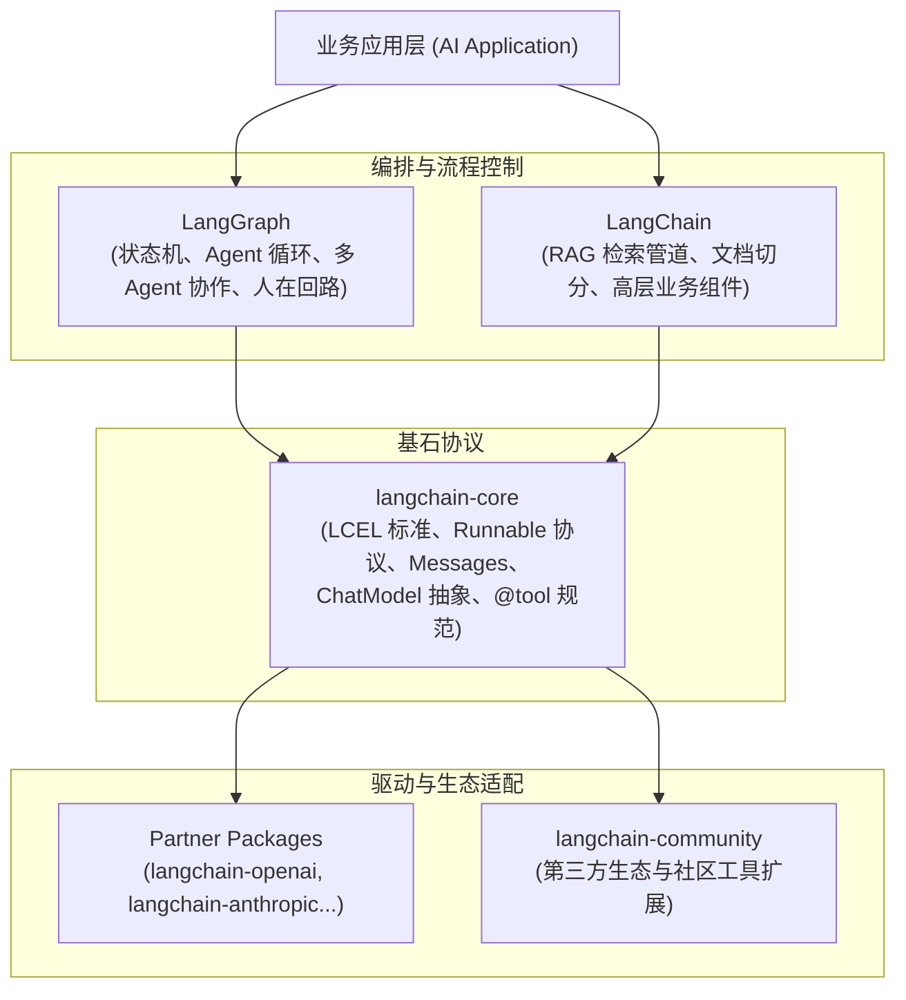
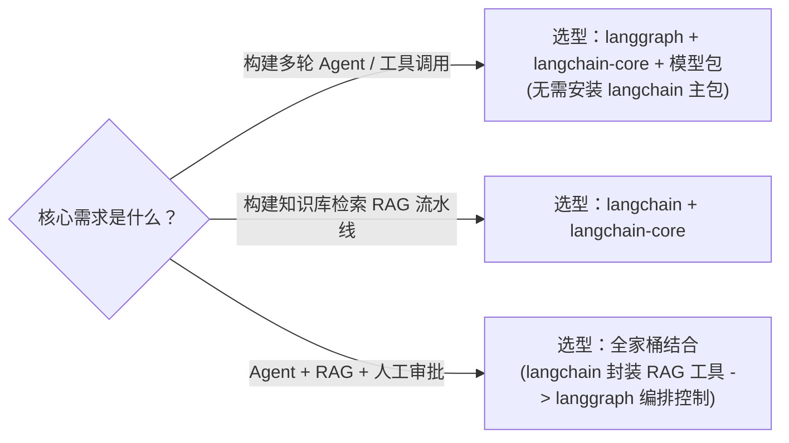

在 LLM 应用开发的早期，许多工程师对 LangChain 的第一印象可以概括为两个字：**爱恨交织**。

一方面，它以极快的速度封装了几乎所有市面上的模型 API、Prompt 模板和向量检索器；但另一方面，过度的抽象黑盒、令人捉摸不透的隐式依赖，以及动辄出现的 `DeprecationWarning`，也曾让不少团队在生产环境踩坑连连。

如果你对 LangChain 的认知还停留在过去的 `AgentExecutor`、`ZeroShotAgent` 或从一个巨型 `langchain` 单体包里导入一切的时代，那么是时候重新审视它了。

经过近两年的彻底解耦与重构，现代 LangChain 已经蜕变为一个分工极度明确、以 **协议标准（`langchain-core`）+ 图状态引擎（`langgraph`）** 为双核心的现代 AI 工程底座。

本文将系统梳理当前 LangChain 生态的架构演进与包协作关系，并重点聚焦自主智能体（Agent）系统的核心基石 —— **工具调用（Tool Calling）**，分享 6 个经过生产验证的最佳工程实践。

---

## 一、 LangChain 核心生态全景与使用关系

当前 LangChain 生态已彻底告别单体巨石架构，形成了层次清晰的金字塔生态：

> **`langchain-core` 是协议基石，`langchain` 是高层业务工具箱（尤以 RAG 见长），而 `langgraph` 则是驱动现代复杂 Agent 与状态流转的核心动力引擎。**

### 1. 架构分层与依赖关系



从依赖流向可以看出：
- `langchain-core` 处于最底层的协议位置，**几乎没有任何冗余的第三方库依赖**，保证了极高的轻量性与稳定性；
- `langgraph` 与 `langchain` 相互平级，且均基于 `langchain-core` 提供的接口进行交互，两者之间**不存在强耦合绑定**；
- 各模型厂商（OpenAI、Anthropic、Google 等）的代码独立为 `langchain-*` 驱动包，更新周期与核心框架完全隔离。

---

### 2. 三大核心包职责对照

为了帮助大家在技术选型时不再困惑，我们通过下表梳理三大核心包的定位与职责差异：

| 维度 | `langchain-core` | `langgraph` | `langchain` |
| :--- | :--- | :--- | :--- |
| **定位** | **标准协议与基础数据抽象** | **有状态 Agent 与循环图编排引擎** | **高层业务组件库与生态粘合层** |
| **依赖程度** | 极低（纯 Python 原生抽象与 Pydantic） | 依赖 `langchain-core`，无沉重三方包 | 依赖 `langchain-core` 及其他相关扩展 |
| **核心管理内容** | 消息抽象（`HumanMessage`, `AIMessage`, `ToolMessage`）、`@tool` 装饰器、LCEL 管道、`BaseChatModel` | 状态图（`StateGraph`）、循环控制（Cycles）、持久化检查点（Checkpointer）、人工审批中断 | 文本切割器（TextSplitters）、向量检索流水线（Retrievers）、复杂文档解析 |
| **执行拓扑** | 单向流式计算（DAG/无环图） | **有状态、支持循环重试与自修正（Cyclic Graph）** | 线性复合流水线 |
| **Agent 支持** | 仅定义工具与消息接口规范 | **官方唯一推荐的现代 Agent 运行时环境** | 旧版 `AgentExecutor` 已废弃 |

---

### 3. 场景化选型与组合路线

在实际项目技术选型时，切忌“习惯性地 `pip install langchain` 全家桶”，应根据具体业务场景按需引入：



- **纯 Agent / 工具调用场景**：直接选用 `langgraph` + `langchain-core` + 对应的模型驱动（如 `langchain-openai`）。该组合没有任何多余的依赖体积，运行时启动快、冷启动延迟极低。
- **纯 RAG 检索流水线场景**：选用 `langchain` + `langchain-core`。使用 `RecursiveCharacterTextSplitter` 和各类 VectorStore 检索器构建 LCEL 线性处理链路。
- **混合自主系统**：用 `langchain` 构建底层的知识库检索模块，通过 `langchain-core` 的 `@tool` 包装成标准工具，再注册到 `langgraph` 的状态机中，由多智能体协同调用并由 Checkpointer 负责持久化与人工审核。

---

## 二、 规范导入路径指引（避坑防错）

在重构后的生态中，最常见的反模式就是从过期的命名空间导入组件，导致弃用警告甚至运行时行为异常。请牢记以下现代导入范式：

```python
# 1. 基础消息类型、Prompt、工具定义 -> 统一从 langchain_core 导入
from langchain_core.messages import HumanMessage, AIMessage, ToolMessage
from langchain_core.prompts import ChatPromptTemplate
from langchain_core.tools import tool, InjectedToolCallId

# 2. 状态机、Agent 执行器、持久化检查点 -> 统一从 langgraph 导入
from langgraph.graph import StateGraph, MessagesState, START, END
from langgraph.prebuilt import ToolNode, create_react_agent, InjectedState
from langgraph.checkpoint.memory import MemorySaver
from langgraph.types import Command

# 3. 具体模型厂商实现 -> 统一从官方独立的 partner 扩展包导入
from langchain_openai import ChatOpenAI
from langchain_anthropic import ChatAnthropic

# 4. RAG 专用的文本切割器与检索器 -> 从专用功能包或 langchain 导入
from langchain_text_splitters import RecursiveCharacterTextSplitter
from langchain.retrievers import ContextualCompressionRetriever
```

> [!NOTE]
> 绝不要再从 `langchain.agents` 中导入 `AgentExecutor`，也不要从 `langchain.chat_models` 导入模型类。这类写法已全数废弃。

---

## 三、 现代工具调用（Tool Calling）6 大最佳实践

在 Agent 系统中，工具（Tools）是连接认知中枢与外部现实世界的桥梁。但在实际工程中，未经良好设计的工具往往是系统崩溃的根源：**参数幻觉、权限越权、巨量数据塞爆上下文、网络抖动引发连锁异常**。

基于现代 LangChain 与 LangGraph 的能力，我们在工程落地中总结了以下 6 大最佳实践。

---

### 实践 1：运行时隐式状态注入（InjectedState）

> [!IMPORTANT]
> **黄金法则**：绝不要让大模型去生成或猜测 `user_id`、租户 ID、当前会话 Token、请求签名或数据库连接句柄。

如果将 `user_id` 作为工具参数暴露给大模型，模型不仅可能产生幻觉编造一个 ID，甚至恶意攻击者可以通过 Prompt 注入诱导模型传入其他用户的 ID，造成灾难性的水平越权。

正确的做法是利用 `Annotated` 与 `InjectedState`。LangChain 在生成下发给 LLM 的 JSON Schema 时，会**自动过滤隐藏**被标记的注入参数；而在执行 `ToolNode` 时，由框架从当前图的运行时状态中自动提取并填充：

```python
from typing import Annotated
from langchain_core.tools import tool, InjectedToolCallId
from langgraph.prebuilt import InjectedState

@tool
def update_user_preference(
    theme: str,
    # 下列两个参数对大模型完全不可见（不会出现在 Function Calling Schema 中）：
    user_id: Annotated[str, InjectedState("current_user_id")],
    tool_call_id: Annotated[str, InjectedToolCallId],
) -> str:
    """更新用户的界面主题偏好（大模型仅感知 theme 参数）。"""
    # 业务逻辑直接且安全地使用框架自动注入的运行期上下文
    print(f"[Audit] 正在为安全上下文用户 {user_id} 处理工具调用 {tool_call_id}")
    return f"已成功将用户 [{user_id}] 的主题设置为 {theme}。"
```

大模型看到的工具描述只有 `theme: str`，没有任何攻击面；而业务逻辑又能保证百分之百从经过鉴权的安全上下文中获取身份标识。

---

### 实践 2：分离模型摘要与重型数据（content_and_artifact）

> [!TIP]
> 当工具调用返回海量数据（例如几万行的 SQL 结果集、高分辨率图像二进制、复杂拓扑结构 JSON）时，**千万不要将其序列化后一股脑塞进 Message History**！

把大型数据集直接塞回模型上下文，会带来三重视重灾难：
1. **Token 账单爆表**：单次调用可能白白消耗数万甚至十万 tokens；
2. **上下文腐化（Context Rot）**：超长噪声淹没模型的注意力，后续推理能力急剧下降；
3. **输出截断**：超过上下文限制导致后续轮次崩溃。

现代 LangChain 提供了 `response_format="content_and_artifact"` 机制。工具函数返回一个二元元组 `(llm_summary_str, raw_artifact)`：
- **`content`**：精简的文本摘要，仅包含 LLM 理解任务进展与规划后续步骤所需的关键信息；
- **`artifact`**：挂载在 `ToolMessage.artifact` 属性上的原始对象，下游节点、前端 UI 或存储层可以直接读取，**完全不参与后续 LLM Prompt 的拼接，Token 消耗为 0**！

```python
@tool(response_format="content_and_artifact")
def query_financial_records(quarter: str):
    """查询指定季度的财务明细数据。"""
    # 模拟从数仓拉取的万级重型数据对象
    large_dataset = {
        "quarter": quarter,
        "items": [{"id": i, "amount": i * 128.5} for i in range(5000)]
    }
    
    # 1. 简要汇报给大模型（仅耗费极少 Token）
    summary = f"成功获取 {quarter} 财务明细，共包含 {len(large_dataset['items'])} 条流水记录。"
    
    # 2. 原始大对象放入 artifact，供前端渲染图表或导出 Excel
    return summary, large_dataset
```

---

### 实践 3：工具驱动图状态更新与流程跳转（Command）

在传统的工具调用范式中，工具仅负责“计算并返回文本”，至于全局状态的修改或者流程流转，必须在外部由专门的节点代码或分支路由（Conditional Edge）判定。这在多分支工单流转、安全降级等复杂场景下极不灵活。

在 LangGraph 中，工具可以直接返回 `Command` 对象，**在工具执行完毕的当下，就地原子化修改全局 State，甚至直接指定下一步跳转的节点**：

```python
from langgraph.types import Command
from langchain_core.messages import ToolMessage
from typing import Annotated
from langchain_core.tools import tool, InjectedToolCallId

@tool
def escalate_to_specialist(
    reason: str,
    tool_call_id: Annotated[str, InjectedToolCallId],
) -> Command:
    """当遇到高危退款或严重投诉时，流转至人工专家节点。"""
    return Command(
        update={
            "needs_review": True,
            "escalation_reason": reason,
            "messages": [
                ToolMessage(
                    content=f"已触发工单升级流程: {reason}，系统已挂起并流转至专家坐席。",
                    tool_call_id=tool_call_id
                )
            ]
        },
        goto="human_specialist_node"  # 动态跨越默认路径，直接跳转到人工接管节点
    )
```

工具从“单纯的数据提供者”升格为“具备业务控制流能力的参与者”，使状态机的拓扑代码更加清晰紧凑。

---

### 实践 4：健壮的异常恢复与模型自愈（Self-Correction）

> [!WARNING]
> 工具调用产生网络超时、数据库参数约束违反或外部 API 400 报错时，如果直接抛出 Python 未捕获异常，会导致整个多轮 Agent 图会话直接中断，用户体验极差。

很多时候，模型的参数传递只是出现轻微格式偏差（如日期格式少传了连字符，或枚举值大小写不一致）。如果把错误信息格式化为工具执行结果喂回给大模型，模型往往能够根据错误提示**自我反思并重新生成正确的参数**。

通过为 `ToolNode` 配置 `handle_tool_errors`，可以优雅实现这种自愈机制：

```python
from langgraph.prebuilt import ToolNode

def format_tool_error(exc: Exception) -> str:
    """将异常捕获并格式化为对模型友好的重试引导"""
    return (
        f"【工具执行异常】: {str(exc)}。\n"
        "请仔细核对参数规范与约束，修正输入后重试；若该方案不可行，请尝试其他替代方案。"
    )

tool_node = ToolNode(
    tools=[update_user_preference, query_financial_records],
    handle_tool_errors=format_tool_error  # 拦截异常并包裹为 ToolMessage 返回给大模型
)
```

通过这一配置，异常不会成为链路终结者，而是转化为促使 Agent 自我调整与修复的反射信号。

---

### 实践 5：高危操作审批与人在回路（Human-in-the-loop）

对于涉及敏感资金转移、线上生产库变更、对外群发邮件等具有不可逆影响的操作，绝对不能交由大模型全自动“裸奔”执行。

借助 LangGraph 提供的持久化检查点（Checkpointer）与中断控制能力，我们可以在工具实际触发前实现毫米级的**“断点暂停”**：

```python
from langgraph.checkpoint.memory import MemorySaver
from langgraph.prebuilt import create_react_agent

# 1. 引入持久化机制（生产环境可换用 PostgresSaver / MongoSaver）
checkpointer = MemorySaver()

agent = create_react_agent(
    model=llm,
    tools=tools,
    checkpointer=checkpointer,
    # 核心：在工具节点执行前暂停执行流程，持久化当前图状态快照
    interrupt_before=["tools"]
)
```

当模型决定调用高危工具并生成了参数时，执行流会在 `tools` 节点前自动中断：
1. 后端或工作流将当前暂存的 `tool_calls` 参数（例如 `转账 50000 元给张三`）推送到运营审批后台；
2. 管理员在前端界面确认无误后点击“同意”；
3. 系统通过相同的 `thread_id` 恢复执行（Resume），工具正式运行。

---

### 实践 6：精细化 Pydantic Schema 与并行控制

工具调用的精准度不仅取决于 LLM 的智商，更取决于工具的 Schema 描述有多清晰：

- **强制类型与边界约束**：充分使用 `pydantic.Field` 附加详细的 `description`、正则验证、数值范围（`gt=0`、`le=100`）以及枚举限制，引导 LLM 一次性生成合格入参；
- **控制工具数量（黄金法则）**：单次向大模型绑定的工具建议严格控制在 **5 ~ 15 个以内**。如果系统有成百上千个工具，应引入前置的**工具检索器（Tool Retrieval）**，先基于用户意图召回 Top-K 相关工具再绑定；
- **显式禁用并行竞争**：模型厂商通常默认开启 `parallel_tool_calls`。但对于有强因果顺序或事务性要求的工具链（例如“先查余额、再扣款、再记账”），应在绑定时显式禁用并行生成，强制模型单步推理：
  ```python
  llm_with_tools = llm.bind_tools(tools, parallel_tool_calls=False)
  ```

---

## 四、 生产级端到端参考实现

下面是一个融合了上述状态注入、Artifact 分离、Pydantic 校验与持久化检查点的完整参考实现：

```python
from typing import Annotated
from typing_extensions import TypedDict
from pydantic import BaseModel, Field
from langchain_core.tools import tool, InjectedToolCallId
from langchain_openai import ChatOpenAI
from langgraph.prebuilt import create_react_agent, InjectedState
from langgraph.checkpoint.memory import MemorySaver

# 1. 定义全局运行时状态
class AgentState(TypedDict):
    account_id: str
    messages: list

# 2. 定义强校验的入参 Schema
class TransferArgs(BaseModel):
    recipient_name: str = Field(description="收款人真实姓名，例如：张三")
    amount: float = Field(description="转账金额，必须大于 0", gt=0)

# 3. 定义具备双输出格式与运行时隐式状态注入的工具
@tool(args_schema=TransferArgs, response_format="content_and_artifact")
def execute_transfer(
    recipient_name: str,
    amount: float,
    account_id: Annotated[str, InjectedState("account_id")]
):
    """发起一笔安全的银行账户资金转账操作。"""
    # 模拟外部银企直连转账业务
    tx_record = {
        "tx_id": "TX_20261027_009988",
        "sender_account": account_id,
        "recipient": recipient_name,
        "amount": amount,
        "status": "SUCCESS",
        "raw_response_bytes": 4096  # 模拟底层交易网关的大体积二进制凭据
    }
    
    # 1. 供 LLM 理解的精炼自然语言摘要
    content = f"已成功从安全认证账户 {account_id} 向 {recipient_name} 转账 ¥{amount:.2f}。"
    
    # 2. 供业务系统与前端消费的原始交易凭证对象
    return content, tx_record

# 4. 初始化模型与带状态检查点的 ReAct Agent
llm = ChatOpenAI(model="gpt-4o", temperature=0)
memory = MemorySaver()

agent = create_react_agent(
    model=llm,
    tools=[execute_transfer],
    state_schema=AgentState,
    checkpointer=memory
)

# 5. 执行与流式消费
if __name__ == "__main__":
    thread_config = {"configurable": {"thread_id": "session_user_88"}}
    initial_input = {
        "account_id": "ACC_66008899",
        "messages": [("user", "麻烦帮我转账 500 元给李四，用于支付项目服务费。")]
    }

    print(">>> Agent 启动运行中...\n")
    for chunk in agent.stream(initial_input, config=thread_config, stream_mode="values"):
        latest = chunk["messages"][-1]
        
        # 拦截并提取底层系统的 Artifact 凭据
        if latest.type == "tool" and hasattr(latest, "artifact") and latest.artifact:
            print("[业务系统拦截] 捕获到交易凭据 Artifact:")
            print(f" -> 交易单号: {latest.artifact['tx_id']}")
            print(f" -> 发起账户: {latest.artifact['sender_account']}")
            print(f" -> 状态: {latest.artifact['status']}\n")
            
        # 捕获 AI 最终给用户的自然语言响应
        elif latest.type == "ai" and latest.content:
            print(f"[AI 最终回复]: {latest.content}\n")
```

---

## 五、 结语

从“单体巨石 + 黑盒 Chain”到“协议分离 + 有状态图”，LangChain 生态在过去两年经历了一次深刻的工业化成熟蜕变。

构建具备可靠工具调用能力的自主 Agent，关键不仅在于选用更强大的大模型，更在于**对工程边界的严格敬畏**：
- 让大模型专注于**意图理解与策略规划**；
- 让隐式注入（`InjectedState`）守好**系统安全与权限底线**；
- 让 `content_and_artifact` 承担**数据减负与 Token 降本**；
- 让 `LangGraph` 的检查点与 `Command` 掌控**确定性的状态流转与人工审批**。

只有当脚手架的工程设计足够坚实，Agent 才能真正从实验 Demo 走向严苛的生产环境。
