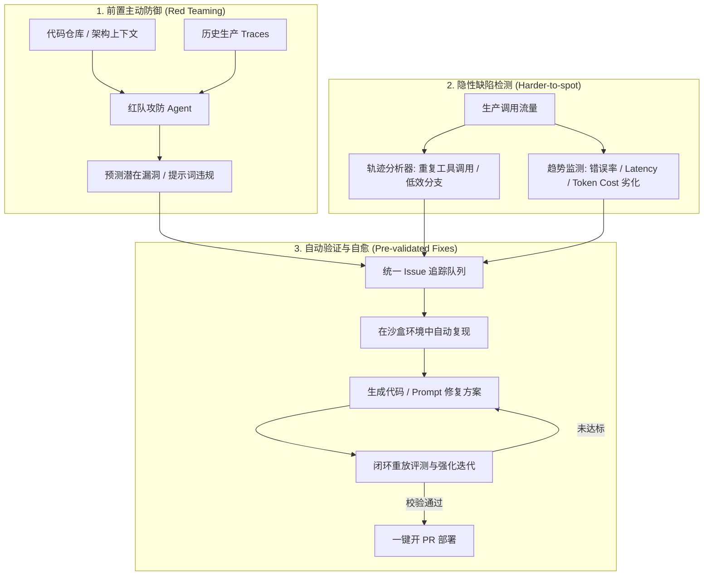

随着大语言模型应用从早期的“单次提示词工程（Prompt Engineering）”演进为具备复杂长任务规划与工具调用能力的 **自主智能体（Agent）**，开发者们很快遭遇了工程落地的最大瓶颈：**不可预测性与难以维护性**。

传统软件工程中，我们可以借助单元测试（Unit Test）、断言与集成测试建立牢固的防线；但 Agent 具备长轨迹（Trajectories）、多分支调用和非确定性输出的特性，往往陷入以下生产困境：
- **偶发越轨与提示词违规**：在边缘 case 下出现幻觉，或无视 System Prompt 的限制；
- **看不见的隐性效率黑洞**：任务看似完成了，但在后台进行了多轮冗余或死循环的 Tool Calling，导致 Token 消耗和延迟指数级膨胀；
- **修复两难**：排查出问题后微调了提示词或逻辑，不敢直接推生产，而全量做回归离线评测又极其沉重。

近日，LangChain 正式发布了 **LangSmith Engine v2**。作为 LangSmith 平台内置的“专门用来优化 Agent 的 Agent”，Engine 自 5 月发布以来已分析了超 7000 万条生产 Traces，而本次 v2 则标志着 Agent 运维与治理从**被动可观测（Passive Observability）**向**主动防御与自愈闭环（Proactive Red Teaming & Self-Healing）**的重大跨越。

本文将深入拆解 Engine v2 的核心机制，并探讨其对生产级 Agent 认知架构与工程实践的深远启示。

---

## 一、 从“监控报警”到“自主改进”：什么是 LangSmith Engine？

在典型的 Agent 开发生命周期（Agent Development Lifecycle, ADLC）中，流程往往包含：**构建（Build）➔ 观测（Trace）➔ 评测（Eval）➔ 改进（Improve）**。

过去，平台只负责把运行时发生的调用记录呈现在界面上（Logging/Tracing），当线上遇到 Badcase 时，依旧需要算法工程师肉眼去翻几百条复杂的 Span 和 Tool Call，手动定位根因并修改代码。

**LangSmith Engine 的本质，是一个常驻平台的 Meta-Agent（元智能体）**：
1. **聚合与聚类**：持续扫描线上 Trace，将语义相似或根因一致的零散报错聚合成同一个 Issue；
2. **归因分析**：自动分析用户意图不满足、工具调用失败或上下文丢失的根因；
3. **知识沉淀**：自动将典型 Badcase 提取并转化为金标评测集（Ground Truth Dataset）。

在 v2 版本中，Engine 进一步扩展了职责边界，将重心放在了**问题的前置暴露（Identifying Issues）**与**修复方案的闭环验证（Validating Fixes）**两个关键节点上。

---

## 二、 Engine v2 的三大核心升级解析

### 1. 红队攻防（Red Teaming）：在用户暴雷前主动“找茬”

传统的可观测工具只能被动等待事故发生。然而，许多严重的问题（如 Prompt Injection、越狱诱导、核心业务规则绕过）在平常低频发生，一旦爆发就是灾难性后果。

Engine v2 引入的 **Red Teaming** 机制实现了主动防御：
- **深度意图理解**：红队 Agent 不仅扫描生产 Trace，还会检索 Agent 项目的代码仓库（Repo），理解系统预期的行为规范与业务边界；
- **对抗性测试生成**：基于业务上下文，自动生成具有欺骗性、边界极限输入或诱导幻觉的对抗测试用例；
- **提前暴露风险**：在漏洞演化为生产事故之前，输出一份高置信度的风险报告并自动归入待办队列。

> [!NOTE]
> 这种“以 AI 攻击 AI”的机制，打破了以往依赖安全团队手动写测试脚本的低效模式，让红队测试常态化、自动化。

---

### 2. 捕捉隐性效率黑洞：从功能正确走向“轨迹健康”

在 Agent 开发中，最隐蔽的 Bug 往往不是 Crash，而是**低效完成**：
- **重复或无序的 Tool Calling**：比如在搜索不到预期信息时，Agent 陷入微调关键词并疯狂重试 10 次的循环，虽然第 10 次成功了，但白白消耗了成倍的 Token，响应时间长达数十秒；
- **隐形劣化趋势**：随着模型版本更新或业务工具增加，系统的错误率、P99 延迟或平均调用成本正在以每周 5% 的速度隐蔽上升，人工很难从日常单条 Trace 中察觉。

Engine v2 引入了**轨迹分析（Trajectory Analysis）**能力：
- 能够识别出 Agent 在执行任务时走过的“冤枉路”，并直接指出更优的路径规划建议；
- 监控关键指标的长期漂移与劣化趋势，提早预警。

---

### 3. 自测自愈闭环：交付真正验证过的 Fix

以往类似 Copilot 的工具给出的修复建议往往让工程师头疼：**谁来证明这段修复是有效的？会不会修了一个 Bug 引发了三个新 Bug？**

Engine v2 结合 **LangSmith Deployment** 打造了完整的自愈循环：
1. **自动复现（Reproduction）**：截获报错的上下文与输入参数，在 Deployment 沙盒环境中执行重放；
2. **方案生成与对抗验证**：针对复现出的失败状态，生成 Prompt 或代码补丁；
3. **闭环评测（Eval Loop）**：将生成的 Fix 应用于沙盒环境，再次重放失败用例和现存基准评测集，评估修复效果；
4. **迭代增强**：若效果未达标，Meta-Agent 会根据评测反馈继续微调代码，直到完全修复且无回归问题；
5. **一键提 PR（One-click PR）**：开发者在控制台看到的不仅是一段干瘪的修复建议，而是附带了**复现证据、前后评测分数对比以及经过实测通过的代码 PR**。

根据官方公布的基准测试数据，相比前代方案，Engine 的问题检测率提升了 **2 倍以上**（基于 IssueBench），生成的修复方案有效性提升了 **25%**（基于 Terminal-Bench）。

---

### 4. 隐私安全：企业私有化支持 BYOK

针对大中型企业和金融、医疗等强监管领域，LangSmith 在其即将推出的私有化自托管（Self-Hosted）版本中支持 **BYOK（Bring Your Own Key）**：
- 企业在自身的 VPC 内托管 LangSmith 并提供专属模型 API Key；
- 生产环境的 Trace 数据全流程保留在内网 VPC 中，解决数据出境与合规焦虑。

---

## 三、 对 Agent 架构设计与工程落地的三点思考

分析完 LangSmith Engine v2 的架构演进，它给一线 Agent 开发者带来了哪些启发？

### 1. 软件工程的“测试飞轮”正在向 Agent 泛化
在经典工程中，测试是代码的守护神；而在 Agent 时代，**评估（Evals）就是 Agent 的单元测试**。
Engine v2 的逻辑清晰地表明：没有与部署沙盒结合的自动化评测，任何所谓的“AI 代码自愈”都是不可信的空中楼阁。只有将**复现 ➔ 修复 ➔ 回归测试 ➔ 提 PR**串联成确定性管道，LLM 驱动的自动化改进才具备生产落地价值。

### 2. 轨迹工程（Trajectory Engineering）成为核心调优指标
以往我们评价 LLM 应用多关注 Accuracy 和 BLEU/ROUGE 分数。而在多轮自主 Agent 中，**轨迹的优雅与紧凑度**同样至关重要。
设计 Agent 状态机时，必须对最大重试步数、工具重复调用阈值、反思（Reflection）收敛条件设置严格的熔断与反馈机制，否则隐性成本会直接拖垮商业模型。

### 3. “Meta-Agent（元智能体）”将成为系统的标配
未来成熟的 AI 系统一定是**多层嵌套**的：一层负责前台业务，另一层（如 Engine）负责后台治理、自我博弈（Red Teaming）、状态调优与自动修复。这种“以 Agent 审查并优化 Agent”的双螺旋模式，正在重构大模型时代的 DevOps 体系。

---

## 四、 结语

从 LangChain 框架到 LangGraph 的状态图编排，再到如今 LangSmith Engine v2 的红队攻防与闭环自愈，LangChain 正在把 Agent 开发从“手工作坊”带向“工业化智能工程”。

对于正在把 Agent 推向复杂生产环境的团队来说，关注可观测性已经远远不够，**尽早建立自动化红队攻防机制与基于沙盒闭环的自测试流水线**，才是保证 Agent 稳定、可靠运行的护城河。
