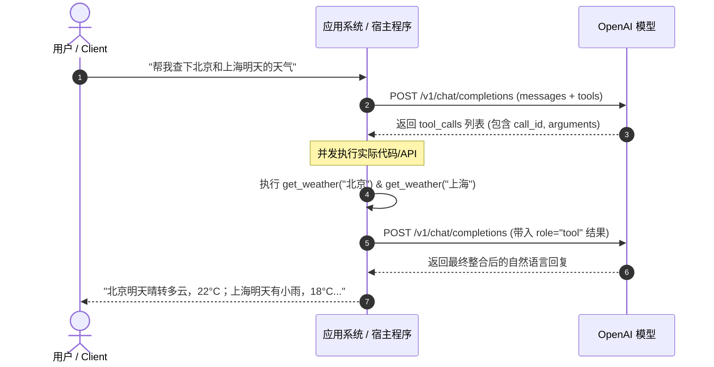

在构建现代 AI Agent（智能体）与复杂大模型应用时，**Tool Calling（工具调用）** 是让大语言模型（LLM）突破纯文本生成限制、接入现实世界数据与系统的核心桥梁。无论是查询实时数据库、调用三方 API，还是驱动操作系统执行特定操作，Tool Calling 都扮演着“控制中枢”的角色。

本文将从**演进历程、协议规范、核心生命周期、进阶特性与工程实践**五个维度，全面拆解 OpenAI Tool Calling 规范与落地指南。

---

## 一、 演进历程：从 Function Calling 到 Tool Calling

大模型与外部系统交互的演进，本质上是“结构化控制能力”与“执行确定性”逐步提升的历史：

| 阶段 | 核心机制 | 局限性与特点 |
| :--- | :--- | :--- |
| **早期阶段 (2022-2023 初)** | Prompt 诱导生成 JSON | 极不稳定，容易出现 Markdown 格式混淆、Schema 幻觉或无法解析的非合法 JSON。 |
| **Function Calling (2023.06)** | 引入 `functions` 参数 | 模型经过微调专门识别函数调用，但单次只能调用一个函数（串行调用延迟极高）。 |
| **Tool Calling (2023.11)** | 引入 `tools` 与 `tool_calls` | 统一工具命名空间，原生支持**并行工具调用（Parallel Tool Calling）**，架构拓展性更强。 |
| **Structured Outputs (2024.08)** | 引入 `strict: true` 严格模式 | 保证生成的参数 **100% 符合 JSON Schema**，彻底杜绝字段缺失与类型不匹配。 |

---

## 二、 工具定义协议规范 (Schema Specification)

在 OpenAI API 中，工具通过请求体中的 `tools` 列表进行声明。目前支持的顶层类型主要为 `function`。

### 1. 工具声明数据结构

```json
{
  "type": "function",
  "function": {
    "name": "get_weather",
    "description": "获取指定城市的实时天气数据。当用户询问天气、气温或出行穿衣建议时调用。",
    "strict": true,
    "parameters": {
      "type": "object",
      "properties": {
        "city": {
          "type": "string",
          "description": "城市名称，例如：'北京'、'Shanghai'"
        },
        "unit": {
          "type": "string",
          "enum": ["celsius", "fahrenheit"],
          "description": "温度单位，默认为 celsius"
        }
      },
      "required": ["city", "unit"],
      "additionalProperties": false
    }
  }
}
```

#### 关键字段规范要求：
1. **`name`**：工具标识符。规则匹配 `^[a-zA-Z0-9_-]{1,64}$`。推荐采用 `snake_case` 或具象的前缀命名（如 `crm_search_customer`）。
2. **`description`**：**最重要的语义引导字段**。模型通过它判断何时触发工具、何时不应触发。
3. **`parameters`**：基于 [JSON Schema Draft 7](https://json-schema.org/) 标准的对象定义。
4. **`strict`（生产强烈建议开启）**：设为 `true` 时启用结构化输出严格模式。在开启时，`parameters` 必须显式声明 `additionalProperties: false`，并且所有属性都必须包含在 `required` 列表中。

---

### 2. 控制调用行为：`tool_choice` 参数

开发者可以通过 `tool_choice` 精细控制模型的决策策略：

| `tool_choice` 取值 | 行为说明 | 适用场景 |
| :--- | :--- | :--- |
| `"auto"` (默认) | 模型自主决定是生成普通文本，还是调用一个或多个工具。 | 常规对话式 Agent、问答助理。 |
| `"none"` | 禁用工具调用，强制生成自然语言回复。 | 即使传入了 tools，仅供模型了解能力背景而不允许触发。 |
| `"required"` | 强制模型**必须**调用至少一个工具，但自主选择调用哪一个。 | 任务分发器、专职工作流路由节点。 |
| `{"type": "function", "function": {"name": "..."}}` | 强制模型必须调用**指定名称**的工具。 | 必须提取参数或确定执行特定动作的首个环节。 |

---

## 三、 完整交互生命周期 (Lifecycle)

Tool Calling 本质上是一个 **“模型决策 $\to$ 宿主执行 $\to$ 结果反馈”** 的回环协议。模型本身并不执行任何真实代码，它只负责输出结构化的执行参数。



### 核心步骤剖析：

1. **发起请求**：客户端传递 `messages` 对话历史与可用 `tools` 列表。
2. **模型决策**：
   - 如果无需工具，模型返回 `finish_reason: "stop"`。
   - 如果需要工具，模型返回 `finish_reason: "tool_calls"`，响应结构位于 `message.tool_calls` 中。
   - 每个 `tool_call` 包含唯一的 `id`（例如 `call_9xAbcd...`）、调用的函数名称 `function.name` 及 JSON 格式的字符串入参 `function.arguments`。
3. **本地执行**：客户端宿主程序解析 JSON 参数，路由并调用真实的外部系统。
4. **回传结果**：客户端将执行结果作为新的消息追加到 `messages`，必须满足：
   - `role: "tool"`
   - `tool_call_id`: 必须与收到的 `id` 一一对应。
   - `content`: 执行结果字符串（通常建议序列化为 JSON 字符串）。
5. **最终整合**：模型读取全部上下文与工具执行输出，生成最终面向用户的自然语言回复。

---

## 四、 生产级 Python 代码范式

以下是基于官方最新 `openai` Python SDK 实现并行工具调用的完整工程范例：

```python
import json
from openai import OpenAI

client = OpenAI()

# 1. 模拟本地业务函数
def get_weather(city: str, unit: str = "celsius") -> str:
    mock_data = {
        "北京": {"temp": 22, "weather": "晴"},
        "上海": {"temp": 18, "weather": "小雨"}
    }
    info = mock_data.get(city, {"temp": 20, "weather": "多云"})
    return json.dumps({"city": city, "unit": unit, **info}, ensure_ascii=False)

# 本地函数路由映射表
TOOL_MAP = {
    "get_weather": get_weather
}

# 2. 声明工具规范
tools = [
    {
        "type": "function",
        "function": {
            "name": "get_weather",
            "description": "查询指定城市的天气与气温信息",
            "strict": True,
            "parameters": {
                "type": "object",
                "properties": {
                    "city": {"type": "string", "description": "城市名称"},
                    "unit": {
                        "type": "string", 
                        "enum": ["celsius", "fahrenheit"],
                        "description": "温度单位"
                    }
                },
                "required": ["city", "unit"],
                "additionalProperties": False
            }
        }
    }
]

messages = [
    {"role": "system", "content": "你是一个智能助理，善于利用工具解决用户的问题。"},
    {"role": "user", "content": "请帮我查一下北京和上海现在的天气。"}
]

# 3. 第一次请求：模型判断是否需要调用工具
response = client.chat.completions.create(
    model="gpt-4o",
    messages=messages,
    tools=tools,
    tool_choice="auto"
)

response_message = response.choices[0].message
tool_calls = response_message.tool_calls

# 4. 模型发起了工具调用
if tool_calls:
    # 必须先把模型的响应（包含 tool_calls）追加到对话历史中
    messages.append(response_message)

    # 遍历并执行所有工具调用（支持并发调度）
    for call in tool_calls:
        fn_name = call.function.name
        fn_args = json.loads(call.function.arguments)
        
        # 执行本地逻辑
        if fn_name in TOOL_MAP:
            tool_output = TOOL_MAP[fn_name](**fn_args)
        else:
            tool_output = json.dumps({"error": f"Tool {fn_name} not found"})

        # 将每个工具的结果单独包装为 role='tool' 消息写回上下文
        messages.append({
            "role": "tool",
            "tool_call_id": call.id,
            "content": tool_output
        })

    # 5. 第二次请求：模型接收工具执行结果，生成最终自然语言答案
    second_response = client.chat.completions.create(
        model="gpt-4o",
        messages=messages
    )
    print("最终回答:\n", second_response.choices[0].message.content)
```

---

## 五、 工程最佳实践与避坑指南

### 1. 工具 Description 的编写原则
* **正面声明“能做什么”**：简明扼要地概括工具的用途与返回值含义。
* **反面声明“何时不要用”**：若系统中有易混淆工具，务必在描述中划清边界。例如：*“仅用于查询历史订单明细，如果要创建新订单请调用 `create_order`”*。
* **边界与约束前置**：注明限制条件，如 *“一次最多支持查询 50 条记录，超出需分页传入 offset”*。

### 2. 拥抱 `strict: true` (Structured Outputs)
在生产环境中，强烈建议使用 `strict: true`。未经过严格约束的 Schema 偶发会出现字段名拼写飘移、漏填必填字段或将数字返回为字符串等情况，容易引发宿主反序列化崩溃。

### 3. 错误自愈设计 (Error as Tool Result)
当本地代码执行抛出异常（如 API 超时、参数校验不通过、数据未查到）时，**切忌直接阻断对话或向用户报错**。应将错误详情格式化为字符串回传给模型：

```json
{
  "role": "tool",
  "tool_call_id": "call_123",
  "content": "{\"success\": false, \"error\": \"城市不存在或拼写错误，请检查输入\"}"
}
```

现代模型具备出色的错误自愈能力，看到错误后通常会主动尝试修正参数重新发起调用，或礼貌地向用户解释并引导重试。

### 4. 安全与权限防护
* **防范间接注入（Indirect Prompt Injection）**：第三方 API 返回的数据可能潜藏恶意指令。对工具返回的 `content` 要做必要的过滤、清洗与最大字符截断。
* **敏感动作人机确认（Human-in-the-Loop）**：对于涉及资金流动、数据销毁、外发邮件等高危操作工具，不可全自动调用。应向用户展示待执行参数并等待显式确认后再执行。
* **调用深度熔断**：为 Agent 的“思考-调用-执行”循环配置最大迭代次数（建议 5-10 轮），防止偶发逻辑分歧造成无限调用死循环，导致 API 资费飙升。
